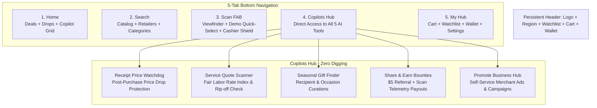

# UX Research & Information Architecture Infrastructure
**Project:** Scout $hopper (OmniCart AI)
**Role:** UX Researcher & UX Architect
**Date:** November 2026

## 1. Executive Summary & Problem Diagnosis

### The Usability Problem
During physical device usability testing, users experienced significant cognitive friction:
1. **Hidden Feature Syndrome**: Flagship value propositions (Receipt Watchdog, Local Contractor Quote Scanner, Gift Finder, Business Sponsor Ads) were buried beneath small horizontally scrolling chip buttons on the Home screen or inside sub-pages.
2. **Tab Inefficiency**: The previous 5 bottom tabs (`[Home, Search, Scan, Watchlist, Cart]`) allocated 40% of primary navigation to transactional lists (Cart & Watchlist), forcing 5 high-value AI copilot capabilities into deep sub-screens.
3. **Hardware Fragility**: Barcode scanning depended strictly on the experimental `BarcodeDetector` API. In environments without native detector support, users saw a silent camera feed with no fallback, causing perceived feature failure.
4. **Mobile Origin Mismatch**: Asset references (`/static/app.js`) and API calls (`fetch('/api/...')`) failed under Capacitor mobile runtimes (`https://localhost`) because assets live at the root and require explicit API host routing.

---

## 2. New 3-Tier Information Architecture (No Buried Features)

### Tier 1: Persistent Global Header
- **Brand Identity**: Scout $hopper logo with active region indicator (e.g., `US · CA` or `CA · AB`).
- **Immediate Cart Access**: Dedicated Cart icon with real-time numeric badge (accessible from any screen with 0 clicks of digging).
- **Immediate Watchlist Access**: Dedicated Tag icon with real-time price-drop notification badge.
- **Rewards Wallet**: Live earnings chip (`$35.00`) displaying available payout balance.

### Tier 2: 5-Tab Navigation Structure
| Tab | Label | Purpose | Key Sub-features |
| :--- | :--- | :--- | :--- |
| **1** | **Home** | Daily pulse & quick actions | Deal of the Day, 4-Card Copilot Suite Grid, Recommended For You. |
| **2** | **Search** | Browse & filter inventory | Full search input, retailer filters, category pills, Shop Small makers. |
| **3** | **Scan** | In-store instant copilot | Live camera, Demo Barcode quick-select pills, manual UPC input, Cashier Shield policy check. |
| **4** | **Copilots** | **All AI Copilot Tools** | Direct 1-tap launcher for Receipt Watchdog, Quote Scanner, Gift Finder, Share & Earn, and Business Ads. |
| **5** | **My Hub** | Unified user dashboard | Watchlist summary, Cart summary, Wallet cash-out, Lifetime Savings milestone ($142.50), Settings. |

### Tier 3: Copilot Feature Cards (Home Screen & Copilot Hub)
Every copilot tool is presented with:
1. High-contrast icon badge (Emerald `#059669`, Amber `#F59E0B`, Indigo `#6366F1`, Violet `#8B5CF6`).
2. Distinct value proposition title.
3. 1-line explanatory microcopy so the user instantly understands what the feature does.
4. Direct tap navigation with persistent back navigation and inter-tool switching.

---

## 3. Engineering & Correctness Enhancements

1. **Relative Asset Paths**: `index.html` loads `./styles.css` and `./app.js`.
2. **Capacitor Mobile API Host**: Automatic routing to `http://10.0.2.2:8000` (Android emulator) or `http://127.0.0.1:8000` (web), with user-customizable host in Settings.
3. **Demo Barcode Quick-Select**: Viewfinder includes 1-tap demo pills for immediate verification of Dyson, Sony, Keurig, Stanley, and Anker products without physical barcodes.
4. **Persistent Demo Session**: `demo_session_token_alex` guaranteed in SQLite for `usr_demo`.
5. **Safe Access Guards**: Safeguards in `addToCart` and `addToWishlist` against empty arrays or missing alternatives.
