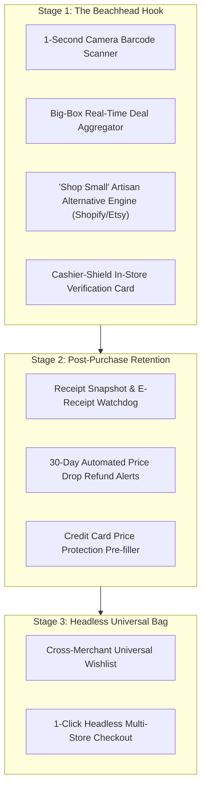
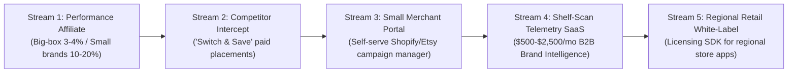

# Project Specification: OmniCart AI — The Autonomous Shopping Copilot

## 1. Executive Summary & Product Identity
* **Product Name:** OmniCart AI
* **Designation:** Autonomous Shopping Copilot & Universal Cart (App Store: *Shopping*)
* **Core Consumer Promise:** "Your personal shopping copilot. The best price on earth, big-box or small maker, online or in the aisle."
* **Pricing for Consumers:** **100% Free Forever.** Zero subscriptions, zero paywalls, zero in-app transaction friction.
* **Core Business Flywheel:** Consumer savings drive hyper-targeted, high-intent foot-traffic and digital purchase traffic; brands, merchants, and retailers finance 100% of the platform through performance bounties, competitor intercept bids, self-serve merchant portals, and B2B shelf-scan telemetry.

---

## 2. Product Roadmap: Scaling Consumer Capabilities

### Stage 1: The In-Store & Online Deal Copilot (MVP Core)
* **1-Second Camera Barcode Scanner:** Hardware-accelerated ML scanner (`mobile_scanner`) with haptic feedback for instant UPC/EAN scans in store aisles.
* **Instant Arbitrage Engine:**
  * Compares physical store shelf price against Amazon, Walmart, Target, Best Buy, and Home Depot.
  * Calculates true bottom-line cost (Item price + Estimated local tax + Shipping threshold).
* **The "Shop Small" Discovery Engine:**
  * Curates high-quality, handcrafted, or boutique alternatives from verified independent Shopify DTC stores and Etsy artisans whenever mass-produced goods are scanned.
* **The Cashier-Shield Policy Card:**
  * Displays 1-tap cashier-ready proof (verifying identical model number, official "Shipped and Sold by" status, and direct store price-match policy URL).

### Stage 2: Post-Purchase Price Protection & Refund Tracker
* **Receipt Capture & Forwarding:** Users snap a paper receipt or connect an email inbox to log purchases.
* **Automated 30-Day Price Drop Watchdog:** The copilot continuously monitors purchase prices across retailers.
* **Refund Claim Assistant:** If a retailer drops their price within the return/adjustment window (e.g., 14–30 days), the copilot alerts the user and auto-generates the retailer refund claim.

### Stage 3: Universal 1-Click Multi-Merchant Bag
* Cross-store unified cart allowing shoppers to combine items from Amazon, Target, and multiple Shopify boutiques into a single transaction without re-entering shipping/payment details repeatedly.

---

## 3. Service Roadmap: Scaling B2B Monetization & Enterprise Revenue

* **Stream 1 (Affiliate & Performance Bounties):**
  * High-intent outbound checkout links generate 3%–4% on big-box electronics and 10%–20% on independent Shopify DTC brands and Etsy creators.
* **Stream 2 (Competitor Intercept Placements):**
  * Brands bid dynamically to display "Switch & Save" alternative cards when high-markup competitor barcodes are scanned.
* **Stream 3 (The "Shop Small" Self-Serve Merchant Portal):**
  * Self-serve portal for independent Shopify and Etsy sellers to configure real-time shelf conquesting campaigns on a pure pay-for-performance model.
* **Stream 4 (Shelf-Scan Telemetry B2B SaaS — Predictable MRR):**
  * Consumer brand manufacturers (CPG, electronics, appliances) pay **$500 to $2,500/month** for real-time dashboards detailing in-store scan events, regional shelf-abandonment rates, and competitor conversion metrics.
* **Stream 5 (Regional Retailer White-Label SDK):**
  * Licensing the price verification and local catalog engine to regional supermarket and hardware chains.

---

## 4. Technical Architecture & Tech Stack

* **Mobile App:** Flutter (iOS & Android)
  * State Management: Riverpod
  * Scanner: `mobile_scanner`
  * Architecture: Clean Architecture (`core`, `features`, `services`, `widgets`)
  * Design: WCAG AA compliant, high-contrast, pure SVG icons (Lucide / Solar)
* **Backend Microservice:** Python (FastAPI)
  * Universal UPC/EAN catalog normalizer (UPCitemdb, Keepa/Rainforest, official APIs)
  * Shopify public catalog ingestion (`/products.json`)
  * Etsy Open API & Affiliate Networks (ShareASale, Impact, CJ)
  * Retailer Policy Rules Engine (Best Buy, Target, Walmart, Home Depot)
* **Cloud & Realtime:** Firebase
  * Firebase Auth (Anonymous guest login + social account upgrade)
  * Cloud Firestore (User carts, scan history, deal watchlists)
  * Firebase Cloud Messaging (FCM) for push notifications (price drops, refund alerts)
* **Telemetry & Ads:**
  * Google AdMob SDK (native feed slots)
  * Anonymized scan event logger for B2B brand portal
